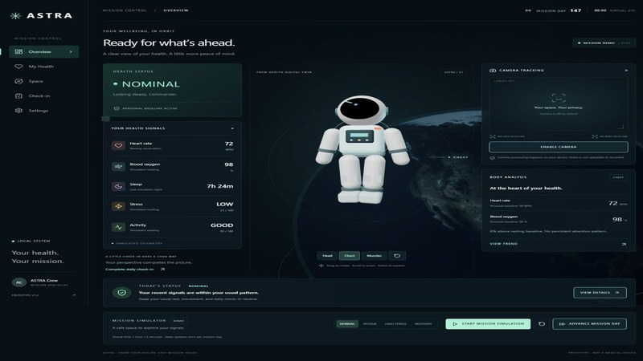
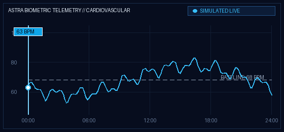
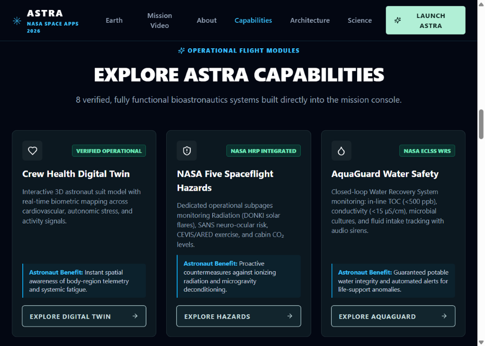

<div align="center">


<br /><br />

# ASTRA
### ASTRONAUT HEALTH MONITOR

**"Beyond Earth. Beyond Limits."**  
*Exploring the future of autonomous astronaut health awareness, physiological digital twins, and closed-loop mission readiness.*

<br />

[](https://www.typescriptlang.org/)
[](https://react.dev/)
[](https://threejs.org/)
[](https://vitejs.dev/)
[](https://vitest.dev/)
[](LICENSE)
[](https://Ashish-004-mar.github.io/astra-astronaut-health-monitor/)

---

### [🌐 Launch Live 3D GitHub Pages Showcase](https://Ashish-004-mar.github.io/astra-astronaut-health-monitor/) · [🛰️ Repository Source](https://github.com/Ashish-004-mar/astra-astronaut-health-monitor) · [🌌 Watch Galaxy Video](docs/assets/astra-galaxy.mp4)

---


<br />

**"Know your health. Stay mission-ready."**  
*An autonomous, on-device bioastronautics intelligence platform engineered to monitor astronaut physiology, cognitive readiness, and closed-loop environmental safety during deep space transit.*

<br />

</div>

## 🛰️ Project Overview

During long-duration deep-space exploration (such as Artemis lunar missions and future crewed Mars transits), crews face extreme communication latencies (up to 22 minutes one-way), cosmic ionizing radiation, microgravity fluid shifts, closed-loop environmental vulnerabilities, and sensory isolation. Ground-based telemedicine cannot provide real-time clinical intervention.

**ASTRA** provides an autonomous, offline-first health monitoring ecosystem designed to give astronauts and flight surgeons an intuitive, explainable, and comprehensive physiological operating picture without requiring cloud connectivity.

---

## 🎬 Cinematic Mission Video & 3D Showcase

The project features a dedicated **3D Space Showcase** hosted on GitHub Pages:

[](https://Ashish-004-mar.github.io/astra-astronaut-health-monitor/)

> 👉 **Click the preview above to open the live interactive showcase**, featuring fullscreen 1080p intro video playback, interactive rotating WebGL Earth, 3D animated architecture, and operational module deep-dives.

---

## 📈 Living Animated Biometric Telemetry

ASTRA features continuous, frame-rate-independent animated biometric telemetry charts:

<div align="center">
  
</div>

- **Scanning Radar Sweep**: A dynamic glowing cyan tracer sweeps across the 24-hour telemetry window to signify active clinical observation.
- **Personal Baseline Envelopes**: Dashed reference lines (e.g., 68 BPM baseline) visualize physiological variances in real time.
- **Multi-Range Examination**: Configurable time intervals across 6H, 24H, 7D, 30D, and full mission duration.

---

## 🔬 Inside ASTRA — System Architecture

ASTRA is architected into 5 discrete, autonomous layers designed for zero-latency execution in deep space:

<div align="center">
  
</div>

```
+-------------------------------------------------------------------------------+
| LAYER 1 // DATA SOURCES                                                       |
| - Deterministic Biometrics  - Crew Check-in Records  - AquaGuard WRS Telemetry|
| - NASA DONKI Space Weather  - MediaPipe Webcam Landmark Vectors               |
+---------------------------------------+---------------------------------------+
                                        |
                                        v
+-------------------------------------------------------------------------------+
| LAYER 2 // LOCAL PROCESSING                                                   |
| - Multi-Day Rolling Baselines  - Safety Rule Engine  - Offline Local Storage  |
+---------------------------------------+---------------------------------------+
                                        |
                                        v
+-------------------------------------------------------------------------------+
| LAYER 3 // MULTI-SYSTEM MONITORING                                            |
| - 3D Digital Twin  - Space Radiation Alerts  - Closed-Loop ECLSS Water Purity|
+---------------------------------------+---------------------------------------+
                                        |
                                        v
+-------------------------------------------------------------------------------+
| LAYER 4 // DECISION SUPPORT                                                   |
| - Explainable Medical Reasons  - Procedural Next Steps  - Tailored Diets      |
+---------------------------------------+---------------------------------------+
                                        |
                                        v
+-------------------------------------------------------------------------------+
| LAYER 5 // USER EXPERIENCE                                                    |
| - Interactive Dashboard  - 160-item Voice Assistant  - 3-Page Vector PDFs     |
+-------------------------------------------------------------------------------+
```

### How ASTRA Works (The Operational Loop)
$$\text{DATA} \longrightarrow \text{MONITOR} \longrightarrow \text{COMPARE} \longrightarrow \text{EXPLAIN} \longrightarrow \text{ACT}$$

1. **DATA**: Biometric streams, check-in records, ECLSS water sensors, and space weather are ingested continuously.
2. **MONITOR**: Displays real-time physiological vitals on the 3D Crew Digital Twin and live Recharts graphs.
3. **COMPARE**: Evaluates deviations against multi-day individualized rolling personal baselines.
4. **EXPLAIN**: Automatically maps anomalies to plain-language aerospace flight surgeon rationales.
5. **ACT**: Provides verified procedural countermeasures (hydration guidelines, exercise adjustments, sleep hygiene).

---

## ⚡ Operational Feature Matrix

<div align="center">
  
</div>

| Subsystem | Core Capability | Provenance / Data Source | Practical Aerospace Benefit |
| :--- | :--- | :---: | :--- |
| **Crew Health Digital Twin** | Procedural 3D spacesuit with anatomical highlight nodes & rotating Earth | `SIMULATED TELEMETRY` | Spatial visualization of biological stress and systemic physiological vitals. |
| **Space Hazards** | Coronal Mass Ejections, solar flares, and geomagnetic storms | `PUBLIC NASA DONKI API` | Direct correlation of cosmic radiation with crew cardiovascular stress and DNA risks. |
| **ASTRA AquaGuard** | Spacecraft closed-loop water purity (TOC in ppb, conductivity, microbial culture) | `ECLSS WRS SPEC` | Enforces NASA Spacecraft Maximum Contaminant Levels (< 500 ppb TOC) during transit. |
| **Mission Nutrition** | Deep space dietary resilience & shelf-life vitamin degradation tracking | `NASA HRP GUIDELINES` | Countermeasures against microgravity muscle atrophy and micronutrient depletion. |
| **2-Min Wellness Check** | Rapid subjective evaluation of crew cognitive readiness, mood, and fatigue | `SELF-REPORTED DB` | Fast, low-burden daily checks stored in local indexed browser database with standalone PDF. |
| **ASTRA Voice Assistant** | 100% offline bilingual companion with 160 curated aerospace medical Q&As | `100% OFFLINE` | Hands-free mission health guidance without remote network latency or privacy leakage. |
| **Camera Vision Tracking** | On-device face/body landmark detection for eye aspect ratio & blink rate | `LOCAL WASM/CPU` | Client-side drowsiness and saccade analysis with zero video storage or transmission. |
| **Daily Health PDF Reports** | 3-page clinical flight surgeon summaries with sparkline trends | `CLIENT-SIDE JSPDF` | In-memory printable documentation ready for Earth sync when comms windows open. |

---

## 🏛️ NASA Official Research References & Data Sources

ASTRA's design, operational envelopes, and health metrics are grounded in peer-reviewed scientific literature and public technical reports published by NASA.

### A. NASA Human Research Program — Five Spaceflight Hazards
- **Official NASA Reference**: [https://www.nasa.gov/hrp/hazards/](https://www.nasa.gov/hrp/hazards/)
- **Scientific Foundation**: Categorizes the 5 primary hazards of long-duration human spaceflight:
  1. *Space Radiation*: Cosmic ionizing radiation and solar energetic particles.
  2. *Isolation and Confinement*: Psychological and circadian stressors during multi-month transit.
  3. *Distance from Earth*: Autonomous clinical operation with communication delays up to 22 minutes.
  4. *Altered Gravity Fields*: Cardiovascular deconditioning, cephalic fluid shift, and muscle atrophy.
  5. *Hostile/Closed Environments*: Closed-loop toxicological limits, cabin air CO₂, and microbial buildup.
- **ASTRA Relevance**: Provides the framework for ASTRA's Space Hazards module, offline resilience architecture, and daily subjective wellness assessments.

### B. NASA Human Spaceflight Health Risks
- **Official NASA Reference**: [https://www.nasa.gov/hrp/risks/](https://www.nasa.gov/hrp/risks/)
- **Scientific Foundation**: Detailed characterization of operational medical risks across cardiovascular, neurological, musculoskeletal, and behavioral health.
- **ASTRA Relevance**: Informs ASTRA's clinical anomaly classification (e.g., correlating sleep deficit with resting heart rate elevation) and countermeasure recommendations.

### C. NASA Spaceflight Standard Measures
- **Official NASA Reference**: [https://www.nasa.gov/reference/standard-measures/](https://www.nasa.gov/reference/standard-measures/)
- **Scientific Foundation**: Core set of longitudinal physiological, behavioral, and sensorimotor measures gathered across pre-flight, in-flight, and post-flight phases.
- **ASTRA Relevance**: Conceptual inspiration for collecting standardized daily wellness logs and tracking multi-day physiological baselines over time. *(Note: ASTRA is an independent prototype and does not claim official implementation of NASA's clinical research protocol).*

### D. NASA Open Science Data Repository (OSDR)
- **Official NASA Reference**: [https://science.nasa.gov/biological-physical/data/osdr/](https://science.nasa.gov/biological-physical/data/osdr/)
- **Scientific Foundation**: Global open repository hosting multi-omics, transcriptomic, and physiological datasets from spaceflight missions.
- **ASTRA Relevance**: Serves as a baseline scientific research reference for spaceflight biomedical parameters and future telemetry model training. *(Classification: RESEARCH REFERENCE — ASTRA does not stream live in-flight astronaut biometric telemetry from OSDR).*

### E. NASA Open APIs — Space Weather Database Of Notifications, Knowledge, And Information (DONKI)
- **Official NASA Reference**: [https://api.nasa.gov/](https://api.nasa.gov/) & [https://kauai.ccmc.gsfc.nasa.gov/DONKI/](https://kauai.ccmc.gsfc.nasa.gov/DONKI/)
- **Scientific Foundation**: Public real-time space weather observations, including Solar Flares (FLR), Coronal Mass Ejections (CME), Geomagnetic Storms (GST), and Solar Energetic Particles (SEP).
- **ASTRA Relevance**: Integrated into ASTRA's Space Weather service (`src/services/spaceWeather.ts`). Fetches public solar flare notifications with autonomous deterministic fallback when network communication is severed. *(Note: Public solar event notices provide general space environmental context and do not represent individual astronaut dosimetric measurements).*

### F. Planetary Visualization & Earth Textures
- **Texture Provenance**: Earth texture maps (`earth.jpg`, `earth_clouds.png`, `earth_lights.png`, `earth_specular.jpg`) originate from Three.js example planetary assets derived from NASA Visible Earth public domain imagery.
- **Scientific Foundation**: NASA Earth Polychromatic Imaging Camera (EPIC) [https://epic.gsfc.nasa.gov/about/api](https://epic.gsfc.nasa.gov/about/api) provides continuous observation of the sunlit side of Earth from the Lagrange 1 point.
- **ASTRA Relevance**: Provides realistic orbital visual continuity for crew psychological grounding and spatial perspective during transit.

### G. NASA International Space Station (ISS) Research and Technology
- **Official NASA Reference**: [https://www.nasa.gov/international-space-station/space-station-research-and-technology/](https://www.nasa.gov/international-space-station/space-station-research-and-technology/)
- **Scientific Foundation**: 25+ years of microgravity research, human physiology studies, and environmental hardware validation aboard the ISS.
- **ASTRA Relevance**: Provides empirical background for microgravity countermeasures, exercise regimes, and medical monitoring technologies.

### H. NASA Spaceflight Nutrition Research
- **Official NASA Reference**: [https://www.nasa.gov/reference/risk-of-inadequate-food-and-nutrition/](https://www.nasa.gov/reference/risk-of-inadequate-food-and-nutrition/)
- **Scientific Foundation**: Evaluates nutrient degradation (Thiamine, Vitamin C, Potassium) over long-duration shelf storage and the metabolic impact of microgravity caloric deficits.
- **ASTRA Relevance**: Forms the scientific basis for ASTRA's Nutrition module (`src/services/nutritionService.ts`), tracking micronutrient stability, caloric expenditure, and countermeasure meal suggestions.

### I. NASA Environmental Control and Life Support Systems (ECLSS)
- **Official NASA Reference**: [https://www.nasa.gov/reference/environmental-control-and-life-support-systems-eclss/](https://www.nasa.gov/reference/environmental-control-and-life-support-systems-eclss/)
- **Scientific Foundation**: Spacecraft engineering standards for closed-loop air revitalization, cabin CO₂ scrubbers, pressure regulation, and water purification.
- **ASTRA Relevance**: Architectural benchmark for ASTRA's Cabin Environment monitoring and toxicological thresholds.

### J. NASA ISS Water Recovery Milestone (2023)
- **Official NASA Reference**: [https://www.nasa.gov/missions/station/nasa-achieves-water-recovery-milestone-on-international-space-station/](https://www.nasa.gov/missions/station/nasa-achieves-water-recovery-milestone-on-international-space-station/)
- **Scientific Foundation**: In June 2023, NASA ECLSS achieved a breakthrough milestone of 98% water recovery in low-Earth orbit using vacuum rotary distillation and brine processing assembly.
- **ASTRA Relevance**: Foundation for ASTRA's AquaGuard module (`src/services/aquaguardService.ts`), which monitors simulated Total Organic Carbon (TOC < 500 ppb), conductivity, and microbial testing in closed-loop ECLSS pipelines. *(Note: ASTRA models and monitors water telemetry; it does not physically process fluids).*

### K. NASA Human Research Roadmap (HRR) — Evidence
- **Official NASA Reference**: [https://humanresearchroadmap.nasa.gov/Evidence/](https://humanresearchroadmap.nasa.gov/Evidence/)
- **Scientific Foundation**: Evidence reports and clinical risk reductions defining spaceflight operational medicine standards.
- **ASTRA Relevance**: Validates the clinical rationale rules and countermeasure logic displayed in ASTRA's daily health summaries.

---

## 📊 Complete Data Provenance & Verification Matrix

| ASTRA Feature / Indicator | Data Source | Data Type | Official Scientific Reference | Implementation Status |
| :--- | :--- | :---: | :--- | :---: |
| **Heart Rate (BPM)** | Client-side simulation engine | `SIMULATED` | NASA Spaceflight Standard Measures | **VERIFIED OPERATIONAL** |
| **Blood Oxygen (SpO₂ %)** | Client-side simulation engine | `SIMULATED` | NASA-STD-3001 Vol 1 & 2 | **VERIFIED OPERATIONAL** |
| **Sleep Duration & Deficit** | Client-side diurnal cycle | `SIMULATED` | NASA HRP Fatigue & Circadian Risks | **VERIFIED OPERATIONAL** |
| **Stress & Cognitive Readiness** | Mathematical variance model | `DERIVED` | NASA HRP Behavioral Health & Performance | **VERIFIED OPERATIONAL** |
| **Crew Wellness Check-in** | Astronaut slider questionnaire | `SELF-REPORTED` | NASA Spaceflight Standard Measures | **VERIFIED OPERATIONAL** |
| **Historical Wellness DB** | Browser LocalStorage / IndexedDB | `LOCAL DATABASE` | ASTRA Offline Architecture | **VERIFIED OPERATIONAL** |
| **Space Weather (Solar Flares)** | NASA DONKI Open API | `PUBLIC NASA DATA` | NASA DONKI API (`/DONKI/FLR`) | **VERIFIED OPERATIONAL** |
| **Cosmic Radiation Threat Index** | Solar event correlation engine | `DERIVED` | NASA HRP Space Radiation Hazard | **VERIFIED OPERATIONAL** |
| **AquaGuard Water Purity (TOC)** | Simulated ECLSS sensor model | `SIMULATED` | NASA JSC Toxicology SMCL (< 500 ppb) | **VERIFIED OPERATIONAL** |
| **AquaGuard Water Conductivity** | Simulated ECLSS sensor model | `SIMULATED` | NASA ECLSS Potable Water Envelopes | **VERIFIED OPERATIONAL** |
| **Microbial Culture Status** | Manual sample logging form | `SELF-REPORTED` | NASA Spacecraft Maximum Contaminant Levels | **VERIFIED OPERATIONAL** |
| **Astronaut Hydration Log** | Manual fluid entry (mL) | `SELF-REPORTED` | NASA Human Health & Performance Directorate | **VERIFIED OPERATIONAL** |
| **Mission Nutrition Galley** | 30-item shelf-life degradation model | `SIMULATED` | NASA HRP Risk of Inadequate Food & Nutrition | **VERIFIED OPERATIONAL** |
| **Facial Landmarks & Blink Rate** | Web camera via MediaPipe WASM/CPU | `LOCAL WASM/CPU` | Google MediaPipe Vision Solutions | **VERIFIED OPERATIONAL** |
| **160-item Voice Knowledge Base** | In-memory aerospace medical database | `100% OFFLINE` | NASA HRP Literature & Aerospace Medicine | **VERIFIED OPERATIONAL** |
| **Daily Health PDF Reports** | Vector document builder (`jsPDF`) | `CLIENT-SIDE JSPDF`| Aerospace Flight Surgeon Documentation | **VERIFIED OPERATIONAL** |
| **3D Earth Globe Visualizer** | Three.js shader / NASA Visible Earth | `DERIVED TEXTURE` | Three.js / NASA Visible Earth Public Domain | **VERIFIED OPERATIONAL** |
| **Spaceflight Omics Datasets** | NASA OSDR Repository | `RESEARCH REFERENCE`| NASA Open Science Data Repository | **RESEARCH REFERENCE** |

---

## 🔍 Scientific Methodology & Transparency

- **NASA HRP Scientific Context**: NASA Human Research Program publications directly inform the selection of physiological risks, spaceflight hazards, and countermeasure recommendations.
- **Simulated Biometrics Disclosure**: All cardiovascular, respiratory, and cognitive metrics displayed on the dashboard are deterministically generated by client-side mathematical algorithms (`src/engine/simulationEngine.ts`). They are designed for technology demonstration and bioastronautics evaluation.
- **Individualized Baseline Computation**: Rather than comparing crew metrics against static terrestrial population averages, ASTRA calculates running multi-day moving baseline envelopes for each astronaut to identify relative physiological deviations.
- **Configurable Demonstration Rules**: Alert thresholds (such as elevated heart rate flags or TOC warnings) are configurable software rules based on published aerospace literature; they are not certified clinical thresholds.
- **Environmental vs. Personal Dosimetry**: NASA DONKI feeds provide macroscopic space weather events (such as solar flares and coronal mass ejections). These events indicate ambient space weather activity and are not personal dosimeter measurements of an astronaut's tissue absorbed dose.
- **Open Research vs. Live Feeds**: NASA OSDR contains archived spaceflight multi-omics and biology research datasets; it does not provide live in-flight telemetry feeds.

---

## 📜 Official NASA Research Acknowledgment

> **"ASTRA draws scientific context from publicly available NASA research and documentation, including NASA's Human Research Program, International Space Station research, NASA Open Science Data Repository, and NASA Open APIs. NASA resources are referenced for educational and research purposes. ASTRA is an independent student-developed prototype and is not affiliated with, endorsed by, or certified by NASA."**

---

## 🌟 Why ASTRA Matters (Core Value Pillars)

1. **Autonomous Deep Space Operation**: Runs 100% client-side without relying on ground cloud servers during communication blackouts.
2. **Personal Baseline Comparisons**: Replaces generic terrestrial averages with personalized multi-day rolling physiological envelopes.
3. **Holistic Physical & Cognitive Tracking**: Bridges cardiovascular telemetry, subjective check-ins, fatigue detection, and nutrition.
4. **Explainable Clinical Guidance**: Every alert includes transparent flight surgeon rationales and specific procedural next steps.
5. **Zero-Leak Client-Side Privacy**: Biometrics, camera landmarks, and voice interactions are processed entirely in browser memory.
6. **Closed-Loop ECLSS Integration**: Direct integration between life support environmental variables (water purity, nutrition) and human health.

---

## 🛠️ Technology Stack

- **UI Framework**: React 19, TypeScript 5.6
- **Build Engine**: Vite 7.3 (ESM, Rollup, PostCSS)
- **3D Graphics & Shaders**: Three.js, React Three Fiber (`@react-three/fiber`), `@react-three/drei`
- **Animation & Transitions**: Framer Motion, CSS Aerospace Glassmorphism
- **Data Visualization**: Recharts (Living charts with scanning radar tracer)
- **Document Generation**: jsPDF (Vector PDF rendering)
- **Computer Vision**: Google MediaPipe Face Mesh & Landmark Detection (CPU/WASM)
- **Audio & Speech**: Web Speech API (SpeechRecognition + SpeechSynthesis)
- **Icons**: Lucide React
- **Testing**: Vitest, React Testing Library, jsdom (12 test suites, 55 passing tests)

---

## 🚀 Installation & Local Development

### Prerequisites
- Node.js 20.x, 22.x, or 24.x
- Modern WebGL2-compatible browser (Google Chrome, Microsoft Edge, Mozilla Firefox, Brave)

### 1. Main ASTRA Application

```sh
# Clone the repository
git clone https://github.com/Ashish-004-mar/astra-astronaut-health-monitor.git
cd astra-astronaut-health-monitor

# Install dependencies
npm install

# Start local application
npm run dev

# Run automated tests (55 tests passing)
npm test

# Build for production
npm run build
```
Application runs locally at: **`http://127.0.0.1:5173/`**

### 2. Standalone 3D GitHub Showcase

```sh
# Navigate into showcase directory
cd github-showcase

# Start local showcase dev server
npx vite

# Build showcase for production
npx vite build
```
Showcase runs locally at: **`http://localhost:5174/`**

---

## 🚢 GitHub Pages Automated Deployment

The 3D showcase is automatically built and deployed to GitHub Pages via GitHub Actions:
- **Workflow**: `.github/workflows/deploy-showcase.yml`
- **Trigger**: Automatic on `push` to `main` branch or manual via `workflow_dispatch`.
- **Target URL**: `https://Ashish-004-mar.github.io/astra-astronaut-health-monitor/`

---

## ⚖️ Data Transparency & Medical Disclaimer

> **IMPORTANT SCIENTIFIC & MEDICAL DISCLOSURE**:  
> ASTRA is an independent educational research prototype and technology demonstration developed for the **NASA Space Apps Challenge 2026**. All physiological biometric telemetry data and check-in scores are deterministically simulated or crew-entered for bioastronautics evaluation. ASTRA is **NOT an FDA-approved medical device, certified clinical diagnostic tool, or a substitute for a licensed aerospace flight surgeon or physician**. It must not be used for actual medical treatment or clinical decision-making.

---

## 🤖 AI Tools Disclosure

In accordance with NASA Space Apps Challenge regulations, development of this project was assisted by **Google Antigravity AI**, used for TypeScript boilerplate structuring, Three.js shader optimization, documentation drafting, and test generation. All aerospace engineering domain models and medical telemetry logic were curated and verified against public NASA research publications.

---

## 👨‍🚀 Mission Credits

- **Developer**: Ashish-004-mar
- **Challenge**: NASA Space Apps Challenge 2026
- **Repository**: [https://github.com/Ashish-004-mar/astra-astronaut-health-monitor](https://github.com/Ashish-004-mar/astra-astronaut-health-monitor)
- **Live 3D Showcase**: [https://Ashish-004-mar.github.io/astra-astronaut-health-monitor/](https://Ashish-004-mar.github.io/astra-astronaut-health-monitor/)

*Ad Astra Per Aspera — Through Hardship to the Stars.*
