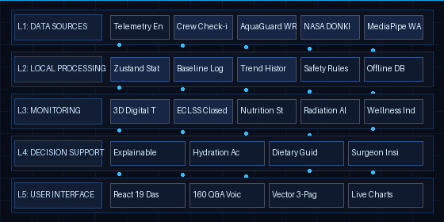

<div align="center">

# ASTRA — Astronaut Health Monitor & Spaceflight Medicine Platform
### NASA Space Apps Challenge 2026


<br />

**"Know your health. Stay mission-ready."**  
*An autonomous, on-device bioastronautics intelligence platform engineered to monitor astronaut physiology, cognitive readiness, and closed-loop environmental safety during deep space transit.*

<br />

[](https://www.typescriptlang.org/)
[](https://react.dev/)
[](https://threejs.org/)
[](https://vitejs.dev/)
[](https://vitest.dev/)
[](LICENSE)
[](https://Ashish-004-mar.github.io/astra-astronaut-health-monitor/)

---

### [🌐 Launch Live 3D GitHub Pages Showcase](https://Ashish-004-mar.github.io/astra-astronaut-health-monitor/) · [🛰️ Repository Source](https://github.com/Ashish-004-mar/astra-astronaut-health-monitor)

---

</div>

## 🛰️ Project Overview

During long-duration deep-space exploration (such as Artemis lunar missions and future crewed Mars transits), crews face extreme communication latencies (up to 22 minutes one-way), cosmic ionizing radiation, microgravity fluid shifts, closed-loop environmental vulnerabilities, and sensory isolation. Ground-based telemedicine cannot provide real-time clinical intervention.

**ASTRA** provides an autonomous, offline-first health monitoring ecosystem designed to give astronauts and flight surgeons an intuitive, explainable, and comprehensive physiological operating picture without requiring cloud connectivity.

---

## 🎬 Cinematic Mission Video & 3D Showcase

The project features a dedicated **3D Space Showcase** hosted on GitHub Pages:

[](https://Ashish-004-mar.github.io/astra-astronaut-health-monitor/)

> 👉 **Click the preview above to open the live interactive showcase**, featuring fullscreen 1080p intro video playback, interactive rotating WebGL Earth, 3D animated architecture, and operational module deep-dives.

---

## 🔬 Inside ASTRA — System Architecture

ASTRA is architected into 5 discrete, autonomous layers designed for zero-latency execution in deep space:

<div align="center">
  
</div>

```
+-------------------------------------------------------------------------------+
| LAYER 1 // DATA SOURCES                                                       |
| - Deterministic Biometrics  - Crew Check-in Records  - AquaGuard WRS Telemetry|
| - NASA DONKI Space Weather  - MediaPipe Webcam Landmark Vectors               |
+---------------------------------------+---------------------------------------+
                                        |
                                        v
+-------------------------------------------------------------------------------+
| LAYER 2 // LOCAL PROCESSING                                                   |
| - Multi-Day Rolling Baselines  - Safety Rule Engine  - Offline Local Storage  |
+---------------------------------------+---------------------------------------+
                                        |
                                        v
+-------------------------------------------------------------------------------+
| LAYER 3 // MULTI-SYSTEM MONITORING                                            |
| - 3D Digital Twin  - Space Radiation Alerts  - Closed-Loop ECLSS Water Purity|
+---------------------------------------+---------------------------------------+
                                        |
                                        v
+-------------------------------------------------------------------------------+
| LAYER 4 // DECISION SUPPORT                                                   |
| - Explainable Medical Reasons  - Procedural Next Steps  - Tailored Diets      |
+---------------------------------------+---------------------------------------+
                                        |
                                        v
+-------------------------------------------------------------------------------+
| LAYER 5 // USER EXPERIENCE                                                    |
| - Interactive Dashboard  - 160-item Voice Assistant  - 3-Page Vector PDFs     |
+-------------------------------------------------------------------------------+
```

### How ASTRA Works (The Operational Loop)
$$\text{DATA} \longrightarrow \text{MONITOR} \longrightarrow \text{COMPARE} \longrightarrow \text{EXPLAIN} \longrightarrow \text{ACT}$$

1. **DATA**: Biometric streams, check-in records, ECLSS water sensors, and space weather are ingested continuously.
2. **MONITOR**: Displays real-time physiological vitals on the 3D Crew Digital Twin and live Recharts graphs.
3. **COMPARE**: Evaluates deviations against multi-day individualized rolling personal baselines.
4. **EXPLAIN**: Automatically maps anomalies to plain-language aerospace flight surgeon rationales.
5. **ACT**: Provides verified procedural countermeasures (hydration guidelines, exercise adjustments, sleep hygiene).

---

## ⚡ Operational Feature Matrix

<div align="center">
  
</div>

| Subsystem | Core Capability | Provenance / Data Source | Practical Aerospace Benefit |
| :--- | :--- | :---: | :--- |
| **Crew Health Digital Twin** | Procedural 3D spacesuit with anatomical highlight nodes & rotating Earth | `SIMULATED TELEMETRY` | Spatial visualization of biological stress and systemic physiological vitals. |
| **Space Hazards** | Coronal Mass Ejections, solar flares, and geomagnetic storms | `PUBLIC NASA DONKI API` | Direct correlation of cosmic radiation with crew cardiovascular stress and DNA risks. |
| **ASTRA AquaGuard** | Spacecraft closed-loop water purity (TOC in ppb, conductivity, microbial culture) | `ECLSS WRS SPEC` | Enforces NASA Spacecraft Maximum Contaminant Levels (< 500 ppb TOC) during transit. |
| **Mission Nutrition** | Deep space dietary resilience & shelf-life vitamin degradation tracking | `NASA HRP GUIDELINES` | Countermeasures against microgravity muscle atrophy and micronutrient depletion. |
| **2-Min Wellness Check** | Rapid subjective evaluation of crew cognitive readiness, mood, and fatigue | `SELF-REPORTED DB` | Fast, low-burden daily checks stored in local indexed browser database with standalone PDF. |
| **ASTRA Voice Assistant** | 100% offline bilingual companion with 160 curated aerospace medical Q&As | `100% OFFLINE` | Hands-free mission health guidance without remote network latency or privacy leakage. |
| **Camera Vision Tracking** | On-device face/body landmark detection for eye aspect ratio & blink rate | `LOCAL WASM/CPU` | Client-side drowsiness and saccade analysis with zero video storage or transmission. |
| **Daily Health PDF Reports** | 3-page clinical flight surgeon summaries with sparkline trends | `CLIENT-SIDE JSPDF` | In-memory printable documentation ready for Earth sync when comms windows open. |

---

## 🌟 Why ASTRA Matters (Core Value Pillars)

1. **Autonomous Deep Space Operation**: Runs 100% client-side without relying on ground cloud servers during communication blackouts.
2. **Personal Baseline Comparisons**: Replaces generic terrestrial averages with personalized multi-day rolling physiological envelopes.
3. **Holistic Physical & Cognitive Tracking**: Bridges cardiovascular telemetry, subjective check-ins, fatigue detection, and nutrition.
4. **Explainable Clinical Guidance**: Every alert includes transparent flight surgeon rationales and specific procedural next steps.
5. **Zero-Leak Client-Side Privacy**: Biometrics, camera landmarks, and voice interactions are processed entirely in browser memory.
6. **Closed-Loop ECLSS Integration**: Direct integration between life support environmental variables (water purity, nutrition) and human health.

---

## 🛠️ Technology Stack

- **UI Framework**: React 19, TypeScript 5.6
- **Build Engine**: Vite 7.3 (ESM, Rollup, PostCSS)
- **3D Graphics & Shaders**: Three.js, React Three Fiber (`@react-three/fiber`), `@react-three/drei`
- **Animation & Transitions**: Framer Motion, CSS Aerospace Glassmorphism
- **Data Visualization**: Recharts (Living charts with scanning radar tracer)
- **Document Generation**: jsPDF (Vector PDF rendering)
- **Computer Vision**: Google MediaPipe Face Mesh & Landmark Detection (CPU/WASM)
- **Audio & Speech**: Web Speech API (SpeechRecognition + SpeechSynthesis)
- **Icons**: Lucide React
- **Testing**: Vitest, React Testing Library, jsdom (12 test suites, 55 passing tests)

---

## 🚀 Installation & Local Development

### Prerequisites
- Node.js 20.x, 22.x, or 24.x
- Modern WebGL2-compatible browser (Google Chrome, Microsoft Edge, Mozilla Firefox, Brave)

### 1. Main ASTRA Application

```sh
# Clone the repository
git clone https://github.com/Ashish-004-mar/astra-astronaut-health-monitor.git
cd astra-astronaut-health-monitor

# Install dependencies
npm install

# Start local application
npm run dev

# Run automated tests (55 tests passing)
npm test

# Build for production
npm run build
```
Application runs locally at: **`http://127.0.0.1:5173/`**

### 2. Standalone 3D GitHub Showcase

```sh
# Navigate into showcase directory
cd github-showcase

# Start local showcase dev server
npx vite

# Build showcase for production
npx vite build
```
Showcase runs locally at: **`http://localhost:5174/`**

---

## 🚢 GitHub Pages Automated Deployment

The 3D showcase is automatically built and deployed to GitHub Pages via GitHub Actions:
- **Workflow**: `.github/workflows/deploy-showcase.yml`
- **Trigger**: Automatic on `push` to `main` branch or manual via `workflow_dispatch`.
- **Target URL**: `https://Ashish-004-mar.github.io/astra-astronaut-health-monitor/`

---

## 📚 NASA Scientific References

1. **NASA Human Research Program (HRP)**:  
   *Risk of Inadequate Food and Nutrition on Long-Duration Exploration Missions*  
   [https://www.nasa.gov/reference/risk-of-inadequate-food-and-nutrition/](https://www.nasa.gov/reference/risk-of-inadequate-food-and-nutrition/)
2. **NASA Environmental Control and Life Support Systems (ECLSS)**:  
   *NASA Achieves 98% Water Recovery Milestone on International Space Station*  
   [https://www.nasa.gov/missions/station/iss-research/nasa-achieves-water-recovery-milestone-on-international-space-station/](https://www.nasa.gov/missions/station/iss-research/nasa-achieves-water-recovery-milestone-on-international-space-station/)
3. **NASA Space Weather Database Of Notifications, Knowledge, And Information (DONKI)**:  
   Space Weather Observations & Real-time APIs  
   [https://kauai.ccmc.gsfc.nasa.gov/DONKI/](https://kauai.ccmc.gsfc.nasa.gov/DONKI/)
4. **NASA Open Science Data Repository (OSDR)**:  
   Spaceflight Omics and Human Health Telemetry Baselines  
   [https://osdr.nasa.gov/](https://osdr.nasa.gov/)

---

## ⚖️ Data Transparency & Medical Disclaimer

> **IMPORTANT SCIENTIFIC & MEDICAL DISCLOSURE**:  
> ASTRA is an independent educational research prototype and technology demonstration developed for the **NASA Space Apps Challenge 2026**. All physiological biometric telemetry data and check-in scores are deterministically simulated or crew-entered for bioastronautics evaluation. ASTRA is **NOT an FDA-approved medical device, certified clinical diagnostic tool, or a substitute for a licensed aerospace flight surgeon or physician**. It must not be used for actual medical treatment or clinical decision-making.

---

## 🤖 AI Tools Disclosure

In accordance with NASA Space Apps Challenge regulations, development of this project was assisted by **Google Antigravity AI**, used for TypeScript boilerplate structuring, Three.js shader optimization, documentation drafting, and test generation. All aerospace engineering domain models and medical telemetry logic were curated and verified against public NASA research publications.

---

## 👨‍🚀 Mission Credits

- **Developer**: Ashish-004-mar
- **Challenge**: NASA Space Apps Challenge 2026
- **Repository**: [https://github.com/Ashish-004-mar/astra-astronaut-health-monitor](https://github.com/Ashish-004-mar/astra-astronaut-health-monitor)
- **Live 3D Showcase**: [https://Ashish-004-mar.github.io/astra-astronaut-health-monitor/](https://Ashish-004-mar.github.io/astra-astronaut-health-monitor/)

*Ad Astra Per Aspera — Through Hardship to the Stars.*
